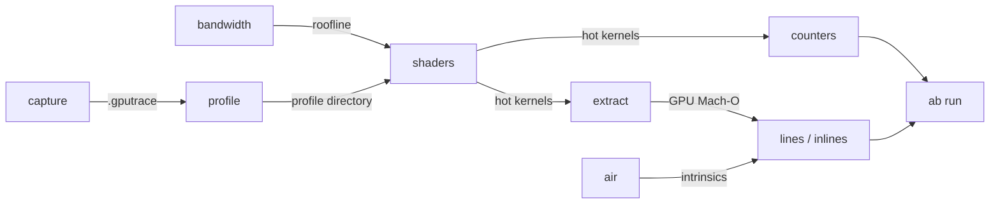

# metal-perf

Command-line instruments for Apple GPU (Metal) compute performance work: measure the bandwidth
ceiling, capture and profile GPU traces without opening Xcode, attribute compiled GPU code to source
lines, read the AIR intrinsics a kernel lowers to, and decide changes with interleaved A/B runs.

It wraps Xcode 27's command-line GPU tools (`gpucapture`, `gpudebug`) and the Metal toolchain
(`metal-objdump`), and parses the formats they produce: `gpudebug` JSON, GPU Mach-O binaries with
DWARF, AIR bitcode archives and `xctrace` exports. Every subcommand prints plain text.

## Install

```sh
cargo install --git https://github.com/computer-graphics-tools/metal-perf --locked
```

Requirements:

- macOS on Apple silicon.
- Xcode 27 or later for `capture` and `profile`: `gpucapture` and `gpudebug` ship with it.
- The Metal toolchain for `air`. Install it with
  `xcodebuild -downloadComponent MetalToolchain` if `xcrun metal-objdump` is missing.

## Workflow



1. **Know the ceiling.** `metal-perf bandwidth` measures peak read and copy bandwidth. A
   memory-bound kernel is judged against this number, not against the datasheet.
2. **Capture a small, representative run.**
   `metal-perf capture --out run.gputrace -- ./my-benchmark --iterations 2` launches the command
   with Metal capture enabled and records every command buffer until it exits.
3. **Replay and profile it.** `metal-perf profile run.gputrace --out prof` replays the trace with
   `gpudebug`, runs the profiler (serial execution, high GPU performance state) and fetches shader
   timelines, every counter group, and compiler statistics for the costliest shaders.
4. **Find where the time goes.** `metal-perf shaders prof` prints GPU time per shader for each
   encoder, with temp registers and spilled bytes from the compiler statistics.
5. **Find why.** `metal-perf counters prof --encoder 1 --group gemm=Gemm --group attention=Attention`
   averages the timeline counters (limiters, bandwidth, occupancy, cache, neural accelerator) over
   the dispatches of each shader group.
6. **Go to the instruction level.** There is no AGX disassembler, but pipelines compiled with
   `-gline-tables-only` carry DWARF. `metal-perf extract --name MyKernel --require-debug --out bin`
   pulls their GPU binaries out of the Metal shader cache. `metal-perf lines bin/X.bin` then gives
   code bytes per source line, and `metal-perf inlines bin/X.bin` gives exclusive code bytes per
   inlined function.
7. **See what the compiler lowers to.** `metal-perf air lib.metallib --function MyKernel --depth 2`
   prints the call tree and `air.*` intrinsic counts. It also reads the AIR archives that implement
   Metal Performance Primitives:

   ```sh
   metal-perf air /System/Library/Frameworks/MetalPerformancePrimitives.framework/Versions/A/Resources/libTensorOps.rtlib \
     --member cooperative_dv_i8_dv_i4_i32_v2 --function 'cooperative_dv_i8_dv_i4_i32_v2$' --depth 3
   ```

   Callees defined in other archive members are pulled in through the archive symbol table.
8. **Decide with interleaved runs.**
   `metal-perf ab run --variant base='./old --bench' --variant new='./new --bench' --metric 'gpu_ms=(\S+)' --out ab`
   alternates the order every round (ABBA), idles before every run so clocks and temperature
   recover, drops the warm-up round, and reports per-round medians, tails and paired ratios against
   the first variant. Re-analyze the logs later with `metal-perf ab report`.

Two more instruments:

- `metal-perf access-pattern` compares two orders of reading the same weight-like matrix: row per
  lane, as a fragment cursor reads a row-major matrix, against contiguous 32-row blocks. It shows
  what a weight repack is worth on this GPU before anyone writes it.
- `metal-perf xctrace export.xml --filter process~my-app --min duration=500000 --group-by call --sum duration,cputime`
  aggregates any table exported with
  `xctrace export --input X.trace --xpath '/trace-toc/run/data/table[@schema="syscall"]'`. Use it
  to check CPU-side gaps between command buffers with a System Trace.

## Reading the numbers

- The profiler's shader intervals and its counter samples use different clocks. `counters` aligns
  each encoder's intervals to the encoder's start. That is accurate for kernels of roughly 40 µs and
  longer. Shorter kernels pick up samples from their neighbours, and the `samples` row shows how
  many samples each column averaged.
- The profiler splits the first dispatch of each pipeline into two intervals. `shaders` merges the
  contiguous pieces.
- Profiling runs are for attribution, not acceptance. Accept a speedup only from uninstrumented,
  interleaved runs: `ab run`.
- Code bytes from `lines` and `inlines` measure code size, not time. AGX instructions vary in
  length.

## Book

`book/` is an mdBook of research notes on GPU compute on Apple M5: the hardware, the Metal 4
execution model, profiling and counters, the compiler and AIR, driver submission, and the WWDC25–26
APIs, with dated evidence under `book/src/evidence/`. Build it with
[mdBook](https://rust-lang.github.io/mdBook/):

```sh
mdbook build book
```

## License

MIT
