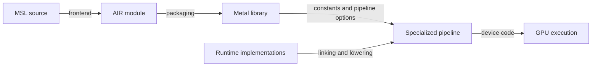

# Compilation and specialization

Metal source describes operations and memory contracts. The compiler specializes those operations for a device and chooses instructions, schedules and registers. Optimize the compiled pipeline used by the workload: an AIR call, a source-level vector or an offline binary alone does not establish execution cost.

## Representations

| Representation | Contains | Does not establish alone |
| --- | --- | --- |
| MSL `.metal` | Types, address spaces, control flow and attributes | Final instruction count, schedule or register use |
| Textual or binary AIR | Typed operations, intrinsics, target and kernel metadata | A one-to-one mapping to physical instructions |
| `.metallib` | Versioned function/module metadata; payload depends on compilation path | Correctness, efficiency or a universal container layout |
| Specialized pipeline | Device-specific compilation, constants and resource limits | Performance on other specializations or devices |
| Captured GPU executable | Code for an identified target and pipeline | The semantics of every encoding or its throughput |

An intrinsic is an operation the compiler recognizes. An ABI specifies the argument types, address spaces and result representation expected by its implementation. Preserve both: an intrinsic's familiar name does not validate a guessed declaration. See the concrete [copy ABI](async-copy.md#typed-copy-interface).

In the inspected G17 runtime-linking route, source function declarations select implementation members by name and declaration order; additional dependencies are then resolved. The linker applies the target triple/layout and prepares linkage. One conditional path runs `AlwaysInlinerPass` followed by `GlobalDCEPass`; a preservation path can retain functions. These build-scoped mechanisms explain why a runtime call in frontend AIR does not establish a final call or its cost. The active branch and exact compiled pipeline still require verification.

Apple documents [precompiled shader libraries](https://developer.apple.com/documentation/metal/building-a-shader-library-by-precompiling-source-files) and [offline binary archives](https://developer.apple.com/documentation/metal/compiling-binary-archives-from-a-custom-configuration-script). An offline configuration must match the runtime function specialization and pipeline state before its output can explain that pipeline.

## Source and pipeline controls

| Control | What it can change | Verification |
| --- | --- | --- |
| Function constants and templates | Eliminate unused paths; specialize shape, layout, alignment and epilogues | Check numerical tails and cache-key completeness |
| Tile shape and execution scope | Reuse, accumulator count and cooperative distribution | Query pipeline limits; inspect registers, spills and staging |
| Vector access and alignment | Address calculations and generated memory operations | Confirm actual alignment, bounds and emitted access behavior |
| Loop unrolling | Branch/address overhead and independent work | Inspect code size and live values; more unrolling can spill |
| Math mode and contraction | Reassociation, precision and multiply/add fusion | State acceptable error before changing options |
| Public SIMD matrix or MPP route | Operand preparation, runtime calls and matrix lowering | Inspect the actual route and measure it for the required shape |

Start with maintained source and pipeline controls. Keep compile time outside dispatch measurements. Retain the source, constants, target, compiler version and library identity for reproducible comparisons.

### Constant memory and compile-time constants

An MSL `constant uint* parameters` argument selects read-only constant memory; values loaded from it can still vary at runtime. Literals, templates and function constants can instead make values known while compiling a specialization.

Compile-time pitches, extents and origins can select an inlined linear-copy implementation. Loading identical values through constant memory does not provide the same specialization.

Specialize stable full-tile layouts and include their values in the pipeline cache key. Keep a separately validated tail/bounds path for irregular tiles. Reduced compiled code is a candidate explanation for better performance; selection still requires numerical coverage and calibrated timing.

### AIR metadata constraints

These compiler-format details apply to compiler `32023.921.6`; they are not stable cross-version interfaces.

| Property | Representation | Constraint |
| --- | --- | --- |
| Maximum workgroup size | `"max-work-group-size"` and `air.max_work_group_size` | Keep declarations consistent; the compiled pipeline determines legal launches |
| Loop unrolling | `llvm.loop.unroll.count` and the loop-unroll pass | Frontend loop structure is not a final instruction count |
| Cooperative INT8 multiplication | `__tensorops_impl_matmul2d_op_run_cooperative_dv_i8_tg_i8_i32_v2` | INT32 partial products, scale application and FP32 accumulation are separate operations |
| Packed INT4 operands | Nibble extraction and widening before INT8 matrix operations | Packed storage does not establish native INT4 multiplication |

Cooperative-storage sizing, element-validity and coordinate operations can be eliminated or transformed during linking. Their presence in frontend AIR does not specify runtime calls, spills or final code size.

### Loop-carried matrix accumulators

A zero-initialized source accumulator can become a loop-carried value. A compiler `phi` selects zero on entry and the previous partial sum on later iterations. A shared loop body can therefore use an accumulating matrix form on every iteration.

Unrolling can expose the first iteration and select a zero-accumulator form separately. Static instruction counts then describe a different control-flow representation of the same logical matrix work. Unrolling can also increase code size and live storage; unchanged threadgroup allocation does not establish unchanged register demand.

See [matrix forms](instruction-set.md#matrix-operations) for accumulating and zero-accumulator encodings.

## Participation-sensitive optimization

A convergent operation depends on the threads executing it together. `readnone` describes memory access; it does not make an active-lane-dependent operation safe to move out of its branch.

On M5 Max with compiler `32023.921.6`, the observed failure sequence is:

| Stage | Verified behavior | Meaning |
| --- | --- | --- |
| Source and store optimization | An input load followed by initial output storage permits output-store merging | Source ordering changes the conditional block's contents |
| `gpu-flattencfg` | Moves the active-lane operation out of the condition in the failing form | Lanes excluded by the source can participate |
| Result | `simd_is_first()`, selected half collectives and selected quad operations return incorrect masked results | Correctness must cover partial masks, not just full groups |
| Reordered-source and `-O0` controls | Pass the bounded tests | A passing control is not a general compiler workaround |

Optimizer cost values are not GPU cycles. Source changes can prevent branch flattening without defining a general workaround. The [execution chapter](gpu-execution.md#collective-correctness) owns the participation limitation.

## Code identity and instrumentation

| Question | Useful instrument | Interpretation |
| --- | --- | --- |
| What operations did the frontend request? | `metal-perf air` | Typed AIR and runtime call trees; no throughput inference |
| Which source or inline contributes code? | `metal-perf extract`, `lines`, `inlines` with available debug data | Attribution for the extracted executable; missing debug data limits coverage |
| What resource use did compilation produce? | `metal-perf profile` and `shaders` | Per-shader instruction categories, temporary registers and spills |
| Which resource limits execution? | `metal-perf counters` | Counter units and sampling coverage must accompany the result |
| Is a candidate faster? | `metal-perf ab run` | Separate, calibrated and uninstrumented comparisons |

Discover installed Apple tool capabilities before use; follow the [profiling procedure](profiling.md). On the inspected toolchain, `air-objdump` advertises AGX targets but cannot print AGX3 instructions, and `metal-objdump -d` can report disassembler failure while exiting zero. Check the diagnostic output as well as the exit status.

Numeric opcode IDs are compiler-build and representation specific. One observed first-active instruction uses ID 14977 in machine IR but canonical ID 14981 when the final bytes are decoded. Metadata attached to the latter cannot be substituted for properties visible to an earlier optimizer. The [instruction reference](instruction-set.md) records supported identities and their scope.

### Program-count boundaries

| Region | Contents | Counting rule |
| --- | --- | --- |
| Main entry | The kernel body beginning at its entry offset | Compare with statistics explicitly attributed to main |
| Constant program | A separately represented preparation program or native prefix | Keep its instructions and registers separate from main |
| Padding / tail | Encoded padding such as repeated `0600` words | Do not assign execution frequency or cost from byte count |
| Complete native text | All regions included in the executable text | Not interchangeable with main-entry instruction count |

Static records, dynamic instructions and profiler invocations are different quantities. Loop bodies can execute repeatedly; separate programs can have different execution scopes.

### Constant-program preparation

The reference G17 driver can copy a supplied constant-program range into the shader state-load stream or retain its code address. Its setup code initializes an inline threshold of 256 bytes and tests the range size before removing trailing NOP words.

| Setup condition | Prepared representation |
| --- | --- |
| Range at most 256 bytes and force-address flag clear | Inline bytes with trailing `0600` words removed |
| Larger range or force-address flag set | Program address; this path does not trim the tail |

This is a build-specific preparation rule, not a public tuning control. Native code size alone does not identify the chosen path: the supplied range and flag also matter. Neither representation establishes execution frequency, physical storage scope or latency.

An inactive address field can remain nonzero on the inline path. Interpret the active representation and its associated fields together; a nonzero pointer alone does not identify address-based preparation.

### Runtime implementation catalogs

Target-specific runtime modules supply implementations used during linking and lowering. The SDK and driver runtime catalogs can differ even when they have the same library name.

The reference driver catalog includes two-dimensional copy helpers `read.noholes`, `read.edgeclamped.noholes` and `read.withholes.v1` under `air.simdgroup_async_copy_2d.`. A catalog containing the one-dimensional helper need not contain these implementations.

An unresolved runtime helper can produce a diagnostic suggesting an architecture limitation. The diagnostic alone does not establish unsupported hardware. Compiler, target, runtime catalog and specialization must be compatible.

A private option setter accepting a value does not establish a change in emitted code or resource allocation. Inspect the compiled pipeline properties relevant to the option.
