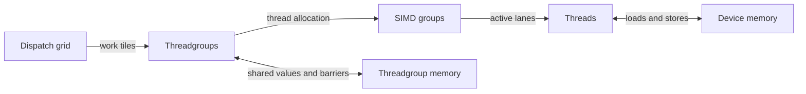

# GPU execution model

A compute dispatch divides its grid into threadgroups. Threads within a group cooperate through SIMD operations and threadgroup memory. Dispatch geometry, participation and synchronization are correctness contracts; register use and memory allocation determine which legal configurations run efficiently.

## Execution scopes



| Scope | Available cooperation | Kernel consequence |
| --- | --- | --- |
| Thread | Private values and control flow | Long-lived values and dynamically indexed private arrays can increase register use or private-memory traffic |
| SIMD group | Lane exchange, collectives and SIMD-group matrices | Read `pipeline.threadExecutionWidth`; it is 32 on the tested M5 Max. A branch can deactivate a subset of lanes |
| Threadgroup | Threadgroup memory and group barriers; executes on one GPU core | Choose a tile with enough reuse to justify staging and synchronization |
| Dispatch | Independent threadgroups accessing device memory | Do not require a particular group execution order or simultaneous residency |
| Command stream | Dependent dispatches, resource lifetime and queue synchronization | Encode the required dependencies explicitly in Metal 4 |

An active mask identifies the lanes executing an instruction. A collective's result can depend on this mask as well as the lane values. Occupancy describes resident SIMD groups relative to the profiler's reported capacity; it is distinct from active-lane fraction and useful arithmetic throughput.

## Pipeline and dispatch contracts

| Property | Set or queried through | Required check |
| --- | --- | --- |
| Threadgroup thread limit | MSL `max_total_threads_per_threadgroup`, pipeline descriptor and `pipeline.maxTotalThreadsPerThreadgroup` | Launch no more threads than the compiled pipeline permits |
| SIMD width | `pipeline.threadExecutionWidth` | Use complete SIMD groups when the algorithm or collective requires them |
| Static threadgroup storage | MSL `threadgroup` allocations; `pipeline.staticThreadgroupMemoryLength` | Include it in the total shared allocation |
| Dynamic threadgroup storage | Encoder `setThreadgroupMemoryLength` | Static plus dynamic storage must fit `device.maxThreadgroupMemoryLength` |
| Tile, dtype and layout | Templates, source definitions and function specialization | Cache and dispatch the pipeline matching the actual tensor contract |
| MPP single-group scope | `execution_simdgroup` | Every thread in that SIMD group calls `run` uniformly; different SIMD groups may diverge |
| MPP multiple-group scope | `execution_simdgroups<N>` | Every thread in the configured scope calls `run` uniformly; MSL 4.1 TensorOps supports N=1 or all SIMD groups in the threadgroup |

The tested device exposes a 32,768-byte threadgroup-memory limit and per-axis threadgroup limits of 1,024. The pipeline's total-thread limit is a separate constraint. These are API limits, not measurements of physical storage or resident threadgroups. See [hardware limits](m5-hardware.md).

`dispatchThreadgroups` specifies a grid in complete threadgroups. `dispatchThreads` specifies a thread grid and can produce smaller edge groups. Tail handling must preserve the participation contract of cooperative loads, barriers and matrix operations.

A whole-SIMD-group predicate can guard a single-group matrix operation; a predicate that excludes only some lanes cannot satisfy that operation's uniform-participation contract. Before skipping a group, also account for any shared-memory writes needed by other groups. Thread-private cooperative tensors do not, by themselves, require a threadgroup barrier. [MSL 4.1, §7.2](https://developer.apple.com/metal/Metal-Shading-Language-Specification.pdf)

## Active-lane rank and count

For integer input `1u`, `simd_prefix_exclusive_sum` gives a lane's rank among lower-index active lanes, and `simd_sum` gives the number of active lanes. These differ from the lane index, the number of valid invocations launched and the nominal SIMD width.

| Quantity | Example: 16 valid lanes, odd lanes active, observing lane 3 |
| --- | ---: |
| Nominal pipeline SIMD width | 32 |
| Valid invocations from the launch | 16 |
| Active-lane rank | 1 |
| Active-lane count | 8 |

An empty active set executes no collective call and produces no per-lane result. An unchanged output slot is not a numeric zero count.

The reference compiler also exposes private `i32()` intrinsics `llvm.agx2.previous.simd.valid.count` and `llvm.agx2.total.simd.valid.count`. Their directly read forms correspond to active rank/count in the covered masked control flow. Read modifiers and arbitrary reconvergence remain unspecified. See [native forms](instruction-set.md#active-lane-count-implementations).

## Collective correctness

A SIMD reduction uses the lanes active at its call. If only lane 17 participates with value 2, a sum returns 2 even when inactive lanes hold 10. `simd_is_first()` identifies the first active lane, which need not be lane zero. Matrix operations have additional uniform-participation requirements. The [Metal Shading Language specification](https://developer.apple.com/metal/Metal-Shading-Language-Specification.pdf) defines the operation-specific contracts.

### Compiler limitation

Compiler `32023.921.6` has a participation-sensitive optimization issue in certain conditional half/SIMD/quad forms. One affected source shape is:

```metal
uint4 v = input[i];
output[i] = uint4(0u);
if (v.y != 0u)
    output[i] = uint4(uint(simd_sum(half(v.x))), lane, sg, width);
```

| Property | Limitation |
| --- | --- |
| Conditional half collectives and selected quad/first-active operations | Optimized forms can include inactive lanes or identify the wrong active subset |
| Branch flattening | `gpu-flattencfg` can remove the condition around the participation-sensitive operation |
| Source reordering or `-O0` | Can change the lowering; neither is a universal workaround |

Preserve active-subset semantics when changing source order, dtype or optimization settings. Full-group correctness does not establish masked correctness. The [compiler reference](compiler.md#participation-sensitive-optimization) describes the transformation boundary.

## Synchronization and memory ordering

A barrier coordinates participating threads and orders the memory domains selected by its flags. An atomic operation makes its update indivisible; it does not automatically publish unrelated data. Visibility, execution order and forward progress are separate requirements.

| Dependency | Required mechanism | Constraint |
| --- | --- | --- |
| Threads produce and consume a shared tile | Appropriate SIMD-group or threadgroup barrier and memory flags | Preserve the participation contract and all writes required by surviving consumers |
| Threads publish device data through an atomic flag | The memory-order and scope contract supported by the chosen API | A relaxed flag alone does not establish publication of other accesses |
| Dispatch B consumes dispatch A's output | Metal 4 barrier, fence or event appropriate to the dependency | Metal 4 has no automatic driver hazard tracking |
| GPU work uses a resource | Resource lifetime and residency management | Residency does not establish producer/consumer ordering |
| One group waits for another group in the same dispatch | No general scheduling guarantee is established here | A group may wait while the producer has no execution resources; prefer a dispatch dependency |

For Apple silicon, [MSL 4.1, §6.10.1](https://developer.apple.com/metal/Metal-Shading-Language-Specification.pdf) specifies that threads which have ended no longer block execution of a threadgroup barrier. This does not make an early return safe when those threads own required shared-tile writes. Termination, divergence at a barrier and missing producers are separate conditions.

## Resource budgets and efficiency

| Change | Potential benefit | Cost to verify |
| --- | --- | --- |
| Larger threadgroup tile | More reuse and less repeated address work | More registers or threadgroup storage; fewer resident groups |
| More independent accumulators | Hide dependent arithmetic latency | Longer live ranges, register pressure and possible spills |
| More SIMD groups per threadgroup | More work sharing and concurrent memory requests | Barriers, shared allocation and less flexible placement |
| Two staging buffers | Opportunity to prepare the next tile during current work | Doubled staging allocation and additional synchronization |
| Separate full tiles from tails | Remove checks from common tiles | Additional specialization; tail path must remain correct |

Read compiled registers, spills and occupancy counters in an attributed [profile](profiling.md). High occupancy can help hide latency, but does not prove high memory or matrix utilization. Tune resource use against the measured limiting unit; do not optimize occupancy as an isolated percentage.

## Metal 4 command execution

`MTL4CommandAllocator` supplies storage for command buffers. A compute encoder records dispatches and synchronization; `MTL4CommandQueue` commits the work. Keep resources resident and alive until GPU use completes. Build pipelines once and cache them using all function constants and compilation options that affect their behavior.

`MTL4CommitFeedback.GPUEndTime - GPUStartTime` measures the GPU span of a commit, including its internal gaps. It does not isolate one dispatch in a multi-dispatch commit. `MTL4CounterHeap` timestamps can provide finer intervals, but inserted stamps can change scheduling. Keep [profiling](profiling.md) separate from [performance acceptance](autotuning.md).
