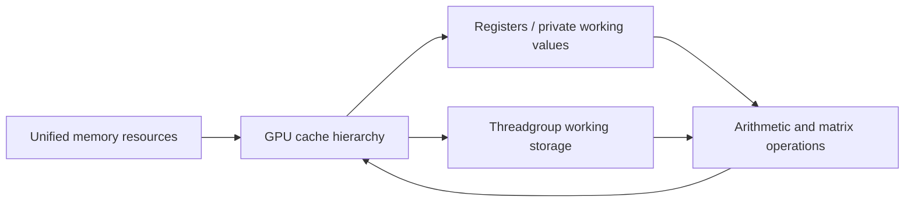

# M5 hardware

An Apple GPU executes many SIMD groups while sharing arithmetic, memory and on-chip storage resources. M5 adds a Neural Accelerator to each GPU core. This GPU matrix hardware is separate from the CPU matrix coprocessor and the Neural Engine. [Apple's M5 ML overview](https://developer.apple.com/videos/play/tech-talks/111432/)

## Device limits

The following values describe the M5 Max reference configuration. API-visible limits and identities do not define physical resource capacities or performance ceilings.

| Property | Observed value | Kernel implication |
| --- | --- | --- |
| GPU | Apple M5 Max, 40 cores | Retune on a different core count |
| Unified memory | 128 GiB | CPU and GPU share a memory system; allocations still have ownership and synchronization rules |
| Metal families | Apple10 and Metal4 supported; Apple11 unsupported | Gate routes with capability queries |
| Maximum threadgroup memory | 32,768 bytes | Static plus dynamic allocation must fit the device and pipeline contracts |
| Device maximum threadgroup dimensions | 1024 × 1024 × 1024 | These are per-axis limits; also obey the pipeline's total-thread limit |
| Recommended working set | Approximately 107.5 GiB | A resource-management recommendation, not a cache size |
| Public counter sets | Timestamp | Additional profiling counters are exposed through Xcode's tools |
| Counter sampling | Stage boundary supported; dispatch, draw, tile and blit boundaries unsupported | Do not infer per-dispatch sampling from stage-boundary support |
| GPU timestamp frequency | 24 MHz | Approximately 41.7 ns per tick; resolution does not imply measurement accuracy |

The device exposes a maximum; the compiled pipeline can impose a lower one. Read `threadExecutionWidth`, `maxTotalThreadsPerThreadgroup` and `staticThreadgroupMemoryLength` for each pipeline.

## Execution resources

| Resource | Role | Efficiency constraint |
| --- | --- | --- |
| Ordinary arithmetic paths | Scalar/vector arithmetic, conversion, address calculations and control | Operand preparation can limit a matrix-heavy kernel |
| GPU Neural Accelerator | Matrix operations through supported TensorOps/MPP routes | Accepted types do not by themselves identify native multiplication precision |
| Registers and private storage | Per-thread live values and temporary arrays | Long live ranges and spills can increase storage pressure and traffic |
| Threadgroup storage | Data explicitly shared within a threadgroup | Staging adds stores, loads and synchronization; reuse must repay them |
| Caches and unified memory | Serve resource accesses at different levels | Logical tensor bytes differ from measured traffic at each interface |
| Occupancy management | Adjusts resident work in response to resource pressure | More resident SIMD groups do not guarantee more progress |

M5's second-generation Dynamic Caching manages on-chip storage used by shader data. Register pressure, L1 pressure and stalled memory requests can influence its occupancy target. Absolute cache sizes, register-file capacity and a universal resident-SIMD-group limit are not established here. [Apple's architecture and profiling overview](https://developer.apple.com/videos/play/tech-talks/111431/)

## Memory model for kernel design

This diagram shows logical data movement. It does not specify physical cache banks, port counts or placement.

| Design decision | Required accounting |
| --- | --- |
| Contiguous/vector loads | Alignment, valid lanes, useful bytes and actual access pattern |
| Cache reuse | Working-set size, repeated-buffer policy and measured interface traffic |
| Threadgroup staging | Source reads + staging writes/reads + barriers + storage pressure |
| Quantized storage | Packed codes + scales/zero points + unpacking/conversion + activation preparation |
| CPU/GPU overlap | Resource synchronization, shared bandwidth and interference |
| Private arrays | Whether indexing remains in registers or produces stack/private accesses |

## Matrix paths

| Programming surface | Verified observation | Boundary |
| --- | --- | --- |
| Public 8×8 SIMD-group matrix operations | Selected half-input/float-output shaders contain family-56 matrix instructions | Does not specify the physical array or peak throughput |
| MPP/TensorOps 16×16×16 floating operation | Selected half/BF16 shaders contain family-64 matrix instructions | Source tile size is not physical array geometry |
| MPP/TensorOps integer operation | Selected signed/unsigned INT8 shaders contain family-77 matrix instructions | Packed low-bit storage is a separate question |
| Mixed half × INT8 | Tested implementation converts integer operands before floating matrix operations | Does not establish native mixed-format multiplication |

See the [instruction reference](instruction-set.md) for build-scoped forms and the [kernel design chapter](matmul.md) for choosing routes.

## Limits that remain unknown

| Unknown | Consequence |
| --- | --- |
| Absolute matrix throughput by dtype | Use measured route controls; do not report a hardware-saturation percentage |
| Cache capacities, bank mapping and replacement | Test layouts and working-set transitions; avoid importing M1/M4 constants |
| Detailed instruction latency and issue width | Validate scheduling hypotheses with dependent and independent work |
| Threadgroup placement and cross-die locality | Do not infer affinity from a dispatch index |
| Fault, preemption and recovery scheduling | Public submission success does not describe these mechanisms |
| Complete graphics and texture execution internals | Compute results cannot establish graphics behavior |
