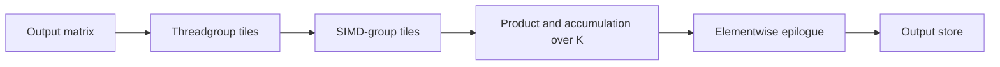

# Matrix operations

A matrix kernel computes output tiles using a defined operand layout, execution scope and accumulation precision. Tile size determines operand reuse, parallel work, edge handling and the amount of live intermediate storage.

## Operation and layout

For matrix multiplication:

```text
D[M,N] = A[M,K] × B[K,N]
```

The mathematical shape is independent of storage order. For a row-major view, element `(row,column)` is located at:

`base + row × row_stride + column × element_stride`

Strides are measured in elements unless an interface explicitly specifies bytes. A transposed view changes coordinate-to-address mapping; it does not necessarily move data.

| Quantity | Definition |
| --- | --- |
| Useful matrix work | `2 × M × N × K` multiply/add operations on logical elements |
| Arithmetic intensity | Useful operations divided by bytes at the named memory interface |
| Logical bytes | Operand, result and metadata representation |
| Physical traffic | Bytes transferred at a measured cache or memory interface |
| Complete operation | Operand preparation, product, reduction or epilogue, and required dependencies |

A quantized representation can reduce logical bytes while adding unpacking, conversion, scale and zero-point work. Logical bytes are not a DRAM-traffic count.

## Execution hierarchy



| Scope | Distribution | Participation |
| --- | --- | --- |
| `execution_simdgroup` | One SIMD group owns the operation | Every thread in that SIMD group calls `run` uniformly |
| `execution_simdgroups<N>` | The operation distributes work across the configured SIMD groups | Every thread in the configured scope participates uniformly |
| Threadgroup grid | Independent output tiles | No fixed order or simultaneous residency is guaranteed |

MSL 4.1 TensorOps supports a single SIMD group or all SIMD groups in the threadgroup for the configured scope. A group-level predicate can select independent single-group operations. A predicate excluding only some threads in an operation's scope does not satisfy its participation requirement. See [execution contracts](gpu-execution.md#pipeline-and-dispatch-contracts).

## Tensor and cooperative storage

An MSL tensor combines a storage pointer with rank, extents and strides. Device and threadgroup tensors describe memory views. A cooperative tensor distributes its elements among the participating threads according to the operation's requirements.

| Representation | Use | Constraint |
| --- | --- | --- |
| Device tensor | Read operands or write results directly in device memory | Bounds, alignment, strides and resource lifetime |
| Threadgroup tensor | Share or rearrange operands between operations | Shared allocation and synchronization |
| Cooperative tensor | Retain distributed intermediate values between compatible operations | Operation-defined element ownership and execution scope |

Use cooperative load/store operations for compatible transfers. Scalar access to individual cooperative elements can inhibit vectorization. A cooperative intermediate can support fusion without a round trip through threadgroup or device memory. Custom thread ownership can require an explicit shared-memory representation.

## Tiling and traversal

| Parameter | Benefit of increasing it | Limiting cost |
| --- | --- | --- |
| Threadgroup M/N tile | More reuse between SIMD groups | Fewer independent tiles, more edge waste and storage pressure |
| SIMD-group M/N tile | More arithmetic per operand load | More accumulators and longer live ranges |
| K step | Less repeated setup and synchronization | Larger working set and more work between barriers |
| Independent accumulators | More independent arithmetic | Additional register/private-storage demand |
| Split-K partitions | More parallel work when output has few tiles | Partial-result traffic, reduction and changed accumulation order |

The [MPP programming guide](https://developer.apple.com/download/files/Metal-Performance-Primitives-Programming-Guide.pdf) gives the following starting points for M5 GEMM with 16-bit floating operands:

| Parameter | Starting point | Applicability |
| --- | --- | --- |
| SIMD-group arrangement | 2 × 2 per threadgroup | Tune for problem size and operand dtype |
| Output tile per SIMD group | 32 × 32 | Larger tiles increase reuse and live storage |
| K interval between synchronization points | 128 | Balance synchronization overhead against cache working set |
| Logical output-tile traversal | Morton order | Improves spatial locality without specifying physical core affinity |
| Aligned full tiles | Static tensor extents | Retain bounds-aware dynamic extents on partial axes |

Explicit threadgroup staging is unnecessary for the guide's optimized GEMM paths. Direct device access allows the cache hierarchy to supply operand reuse. Additional staging and software pipelining require a benefit that exceeds their storage, transfer and synchronization costs.

Periodic `threadgroup_barrier(mem_flags::mem_none)` can keep SIMD groups closer together along K and limit cache-working-set growth. This coordinates execution without requesting a memory fence. It does not replace visibility operations needed by a shared-memory producer/consumer.

## Bounds and specialization

Static extents allow the compiler to eliminate checks for aligned full tiles. Function constants can select aligned and partial-tile paths. Use dynamic extents on an axis requiring bounds checks.

An empty output tile can still own input preparation or shared-memory writes required by other participants. Return early only when both the cooperative execution scope and all data dependencies remain satisfied.

## Accumulation and precision

Source mode and native accumulator representation are separate properties. Device-destination multiply-accumulate can lower to a zero-accumulator matrix operation followed by additions. Compatible cooperative destinations can use tied matrix accumulator registers. The [native matrix forms](instruction-set.md#matrix-operations) describe the build-specific encodings.

Preserve input signedness, conversion rules, accumulator precision and reduction order. Relaxed FP32 matrix arithmetic has a separate [precision scope](instruction-set.md#strict-and-relaxed-fp32). Reassociation can change cancellation and final rounding.

Packed low-bit storage does not establish native low-bit multiplication. The reference INT8×INT4 implementation widens packed nibbles before integer matrix operations; mixed half×INT8 converts the integer operand before floating matrix arithmetic.

## Epilogues and quantized operands

An epilogue applies operations to the matrix result before its final store. Bias, scaling, conversion and elementwise activation can be fused while the result remains in compatible cooperative storage.

For a quantized value `w = scale × (code - zero_point)`, packing, group boundaries and signedness belong to the operand contract. Scale conversion and application remain part of the complete operation even when the matrix product uses native integer instructions.

Fusion reduces intermediate transfers and dispatch overhead, but can increase live storage and constrain the numerical ordering. Compare complete operations with the same output requirements using the [measurement procedure](autotuning.md).
