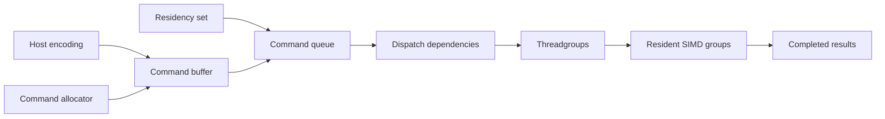

# Submission and scheduling

Metal submission and GPU instruction scheduling are separate layers. The host makes work and resources available, dependencies determine when it may run, and the GPU schedules threadgroups and SIMD groups. Reducing host overhead does not establish better shader occupancy.

## Resource and command lifecycle

| Object / boundary | Required behavior | Performance consequence |
| --- | --- | --- |
| Command allocator | Preserve its command memory until submitted work finishes; reset only when safe | Reuse avoids allocation, but premature reuse corrupts in-flight work |
| Command buffer | Encode the intended operations and finish encoding before submission | Grouping work amortizes host overhead |
| Residency set | Make every referenced resource available for execution | Resource accessibility is separate from shader occupancy |
| Buffer lifetime | Keep resources alive until their consumers complete | Reusing storage early is a correctness failure |
| Queue completion / commit feedback | Establish completion before CPU consumption or reuse | CPU waiting can serialize an otherwise asynchronous pipeline |
| Pipeline creation / archive lookup | Finish required compilation before steady-state timing | Startup cost and dispatch cost are separate quantities |

Metal 4 gives the application explicit control over command memory and resource residency. Consult the [Metal 4 core API](https://developer.apple.com/documentation/metal/understanding-the-metal-4-core-api) for the lifecycle contract.

## Dependency scopes

Encoding two dispatches in source order is not sufficient to describe every resource dependency in Metal 4. Use the synchronization primitive whose scope covers the producer and consumer. [Resource synchronization](https://developer.apple.com/documentation/metal/resource-synchronization)

| Dependency | Appropriate boundary | Common error |
| --- | --- | --- |
| Lanes in one SIMD group | Matching SIMD operation or SIMD-group synchronization contract | Assuming inactive lanes participate |
| Threads sharing threadgroup storage | Threadgroup barrier with the required memory flags | Only some threads reach the barrier |
| Dependent dispatches within a pass | Dispatch/encoder-stage barrier covering the resource access | Treating encode order as a complete hazard dependency |
| Dependent passes | Supported fence/barrier contract | Using a narrower shader-local barrier |
| Work on separate queues | Event/shared-event ordering as required | Assuming a queue-local dependency covers another queue |
| GPU output consumed by CPU | Completion plus the storage-mode visibility contract | Reading after encoding but before completion |

An execution barrier and a memory-visibility operation answer different questions. A `mem_none` barrier can coordinate execution without requesting a memory fence; it cannot replace the visibility required by a shared-memory producer/consumer.

## Implementation structure

The build 26A434 driver below these public boundaries is described in [command and private memory](command-memory.md), [firmware interface](firmware-interface.md), [faults and recovery](faults-recovery.md) and [memory translation](memory-translation.md). These layers do not establish the number of resident SIMD groups or a hardware scheduling policy.

## Pipeline scheduling controls

The macOS 27 SDK exposes the following controls. Their names do not establish a hardware guarantee.

| Control | Interface behavior | Constraint |
| --- | --- | --- |
| `forwardProgressUsage` | Automatic=0, Weak=1, SIMDGroupParallel=2 | The requested policy does not establish achieved concurrency |
| `contentionRelief` | Automatic=0 or None=1; descriptor defaults to Automatic | The name alone does not specify a performance effect |
| `optimizeForPersistentKernel` | Descriptor defaults off | Does not define a resident-grid density |
| Persistent-grid recommendation | A pipeline can return zero | Zero supplies no usable dispatch-size recommendation |

## Diagnosing scheduling cost

| Symptom | Controlled measurement | Interpretation limit |
| --- | --- | --- |
| Small kernel has high wall time | Separate host encode, submission, GPU span and completion wait | Wall time alone cannot locate the cost |
| Gaps between commits | Compare consecutive GPU start/end times; inspect system trace if needed | Instrumented trace gaps can include tracing overhead |
| Larger threadgroup is slower | Hold useful work constant; profile occupancy influences, registers and memory traffic | Pipeline limits are not residency measurements |
| Many small dependent dispatches | Compare the complete operator with a lawful fused/batched version | Include added synchronization and temporary traffic |
| Low matrix utilization | Inspect operand preparation, dependencies and enough parallel tiles | A matrix counter alone cannot identify the cause |

Changing the compiled maximum workgroup bound and changing the actual dispatch size are independent experiments. Both must preserve the pipeline and execution-scope contracts. The controls above do not promise concurrency or establish forward progress for an arbitrary cross-group polling algorithm.
